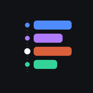
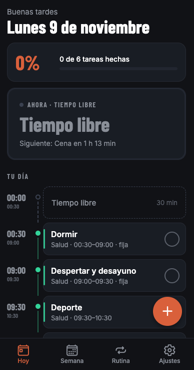
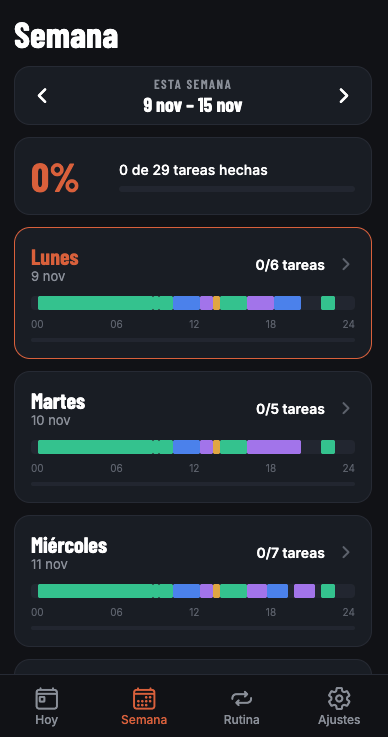
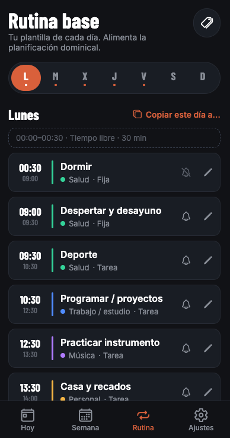
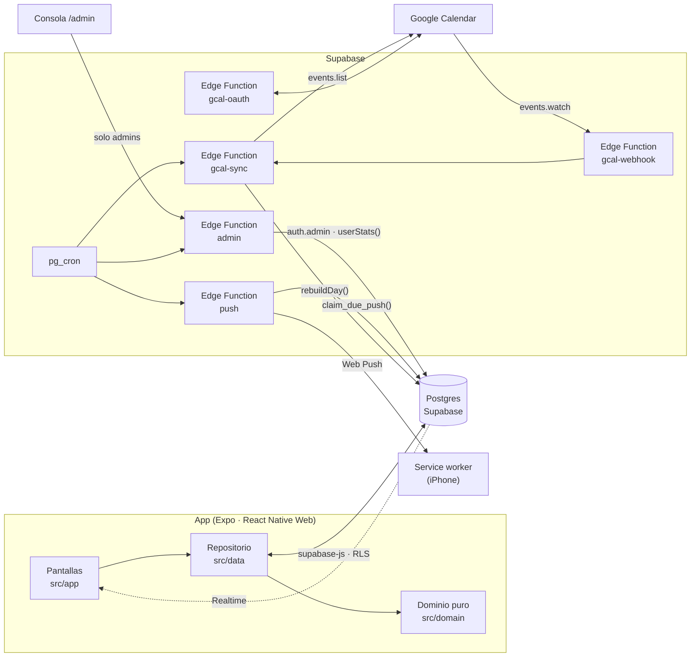

<div align="center">



# Mi Día

**Tu día, bloque a bloque.** Una rutina base, planificación los domingos y, en cada momento, qué toca hacer ahora y qué viene después.

[](https://docs.expo.dev/)
[](https://www.typescriptlang.org/)
[](https://supabase.com/)
[](https://web.dev/explore/progressive-web-apps)
[](https://mi-dia-app-seven.vercel.app)

[**Abrir la app**](https://mi-dia-app-seven.vercel.app) · [Especificación](docs/mi-dia-spec.md) · [Puesta en marcha](docs/puesta-en-marcha.md)

</div>

> **¿Quieres probarla?** Entra en la [app](https://mi-dia-app-seven.vercel.app) con la cuenta de demostración: **`demo@example.com`** / **`midia-demo-2026`**. Toca lo que quieras: los datos vuelven a los de ejemplo cada noche.

<p align="center">
  
  &nbsp;
  
  &nbsp;
  
</p>

---

## Qué hace

| | |
|---|---|
| 🕒 **Ahora y después** | La vista **Hoy** muestra la actividad en curso con su cuenta atrás, la siguiente y el progreso de tareas del día. Los huecos aparecen como «Tiempo libre». |
| 🔁 **Rutina base** | Una plantilla por día de la semana (lunes → domingo). Las actividades que cruzan medianoche se parten solas en dos. |
| 🗓️ **Planificación dominical** | Cada domingo se genera la semana siguiente, desde la rutina o copiando la anterior. El aviso del domingo abre directamente el asistente. |
| 📌 **Eventos puntuales** | Un ensayo o una cita recorta, parte o sustituye lo que pise de la rutina. Se puede volver atrás con «Restaurar rutina de este día». |
| 📅 **Google Calendar** | Trae, casi en tiempo real, los eventos de los calendarios que elijas. Solo lectura: Google siempre gana, y la rutina vuelve sola al hueco cuando un evento se mueve o se borra. |
| 🔔 **Avisos** | Notificación al empezar cada actividad: «Hasta las 12:30 · Siguiente: Comida». En la web, Web Push enviado desde el servidor, también con la app cerrada. |
| ✅ **Hecho y notas** | Marca las tareas de hoy y añade notas. Las actividades «fijas» (dormir, comer) no cuentan para el progreso. |
| 📴 **Sin conexión** | La app y la última lectura de hoy y de la semana se guardan en el dispositivo. |
| 🛠️ **Consola de administración** | Una cuenta separada con su propia consola (sidebar en escritorio, menú en el móvil): resumen de uso, alta y gestión de usuarios con sus estadísticas, demo, Google Calendar y estado del sistema. |

Todo en español, formato 24 h, semanas de lunes a domingo y hora de `Europe/Madrid`, independientemente de la zona del dispositivo.

---

## Arquitectura



**Principios**

- **Una sola puerta a los datos.** Las pantallas solo hablan con `src/data` (repositorio). Debajo hay dos *stores* intercambiables: Supabase y uno en memoria con datos de prueba, que se usa automáticamente si no hay claves.
- **Reglas de negocio en funciones puras.** Recortes de eventos, medianoche, solapes, huecos, progreso y semanas viven en `src/domain`, sin React ni red, cubiertos con tests.
- **El mismo código en cliente y servidor.** Las Edge Functions (Deno) usan exactamente la lógica de `src/domain`, empaquetada con esbuild (`npm run build:functions`). `npm test` falla si el paquete se queda atrás.
- **Cambios atómicos.** Las operaciones que tocan varias filas de un día van en una sola transacción (`apply_day_changes`): un día nunca queda a medias.
- **Seguridad en la base de datos.** Row Level Security en todas las tablas, permisos por columna para que los tokens de Google no sean legibles desde la app, y funciones de servidor solo para `service_role`. Los permisos de cada usuario (admin, demo, Google) viven en `user_flags`, que la app puede leer pero nunca escribir.
- **Demo pública sin riesgo.** La cuenta de demostración está aislada por RLS como cualquier otra, no ve Google ni la administración, y cada noche recupera sus datos, su email y su contraseña.

---

## Stack

| Capa | Tecnología |
|---|---|
| App | [Expo SDK 58](https://docs.expo.dev/), React Native 0.88, React 19, [Expo Router](https://docs.expo.dev/router/introduction/), TypeScript estricto |
| Web | React Native Web, PWA instalable con service worker propio, desplegada en [Vercel](https://vercel.com/) |
| Backend | [Supabase](https://supabase.com/): Postgres, Auth (email + contraseña, registro cerrado), Realtime, Vault |
| Servidor | Supabase Edge Functions (Deno), `pg_cron` + `pg_net` |
| Avisos | Web Push (VAPID) en la web · `expo-notifications` en nativo |
| Integraciones | Google Calendar API (OAuth 2.0, `calendar.readonly`, canales push) |
| Calidad | Jest (`jest-expo`), tests SQL con [PGlite](https://pglite.dev/), ESLint (`expo lint`), `deno check` |

---

## Empezar

**Requisitos:** Node.js 22.13+ (o 24.3+) y npm.

```bash
git clone https://github.com/PabloVillagranGonz/mi-dia-app.git
cd mi-dia-app
npm install

npm run web        # en el navegador
npm start          # Expo (iOS / Android / web)
```

Sin configuración, la app arranca con **datos de prueba en memoria** (`src/data/mock/`): la rutina de ejemplo, sin login ni red.

### Conectar con Supabase

Copia `.env.example` a `.env.local` y rellena las claves públicas del proyecto:

```bash
EXPO_PUBLIC_SUPABASE_URL=https://xxxx.supabase.co
EXPO_PUBLIC_SUPABASE_KEY=sb_publishable_xxxxxxxx
```

Después ejecuta las migraciones de `supabase/migrations/` en orden. La guía completa (proyecto, Auth, avisos, cron, Google Calendar y alta de usuarios) está en **[docs/puesta-en-marcha.md](docs/puesta-en-marcha.md)**.

> `.env.local` y las credenciales de Google (`client_secret_*.json`) están en `.gitignore`. Los secretos del servidor se guardan en *Edge Functions → Secrets* y en Vault, nunca en el repositorio.

---

## Scripts

| Comando | Qué hace |
|---|---|
| `npm start` · `npm run web` · `npm run ios` | Arranca Expo |
| `npm test` | Tests de Jest (dominio y repositorio). Antes comprueba que el paquete de las Edge Functions está al día |
| `npm run test:sql` | Levanta un Postgres embebido (PGlite) con las migraciones reales y prueba avisos, RLS y permisos |
| `npm run typecheck` | `tsc --noEmit` |
| `npm run lint` | ESLint (`expo lint`) |
| `npm run build:functions` | Empaqueta `src/domain` para Deno en `supabase/functions/_shared/domain.js` |
| `npm run check:supabase` | Comprueba la conexión con el proyecto de Supabase |

Antes de dar algo por terminado: `npm run typecheck && npm run lint && npm test && npm run test:sql`.

---

## Estructura

```
src/
  app/              Rutas de Expo Router. (tabs)/ = Hoy · Semana · Rutina · Ajustes · admin/
  components/       UI: TimelineBlock, NowCard, ActivitySheet, WeekDayCard, GoogleCalendarSettings…
  data/             Repositorio, tipos y stores (mock/ y supabase/). Única puerta a los datos
  domain/           Lógica pura y testeada: horas, medianoche, eventos, semanas, rebuildDay…
  hooks/            useNow, useRepoQuery, useRemoteChanges…
  notifications/    Locales en nativo, Web Push en la web (*.web.ts)
  theme/            Colores, tipografías y espaciados
supabase/
  migrations/       Esquema, RLS, funciones SQL y crons (0001 → 0009)
  functions/        Edge Functions: push, gcal-oauth, gcal-sync, gcal-webhook, admin
public/             index.html, manifest, iconos, service worker y política de privacidad
scripts/            Service worker, paquete de funciones, tests SQL
docs/               Especificación, guía de puesta en marcha y capturas
```

Los archivos `*.web.ts(x)` son variantes solo para la web (diálogos, selector de hora, márgenes seguros, avisos).

---

## Modelo de datos

| Tabla | Contenido |
|---|---|
| `categories` | Categorías con color (Trabajo / estudio, Música, Salud, Personal…) |
| `template_activities` | Rutina base: una fila por actividad y día de la semana |
| `weeks` | Semanas generadas (desde la rutina, copiando la anterior o automáticamente) |
| `day_activities` | Actividades concretas de cada día: origen (`template`, `event`, `manual`), hecho, nota, `external_id` si viene de Google |
| `settings` | Recordatorio de planificación y avisos |
| `push_subscriptions` · `push_log` | Dispositivos con Web Push y avisos ya enviados |
| `google_accounts` · `google_calendars` · `google_events` | Conexión con Google, calendarios elegidos y eventos sincronizados |
| `user_flags` | Qué es cada usuario: administrador, demo, acceso a Google |

Las horas se guardan como `time` local + `date`, nunca como timestamps. Los detalles y las reglas están en la [especificación](docs/mi-dia-spec.md).

---

## Despliegue

- **Web:** cada `git push` a `main` se publica en Vercel (`npx expo export -p web && node scripts/build-sw.mjs`). En el iPhone: Safari → Compartir → **Añadir a pantalla de inicio**. La versión nueva se descarga sola la siguiente vez que se abre.
- **Base de datos:** `npx supabase db query --remote=<ref> -f supabase/migrations/000X_….sql`.
- **Edge Functions:** `npx supabase functions deploy <nombre> --remote=<ref> --no-verify-jwt --use-api`. Cada función comprueba la sesión o su secreto por sí misma.

---

## Documentación

- **[Especificación](docs/mi-dia-spec.md):** decisiones, modelo de datos, reglas de negocio y pantallas.
- **[Puesta en marcha](docs/puesta-en-marcha.md):** Supabase, PWA, avisos, Google Calendar y usuarios, paso a paso.
- **[Política de privacidad](https://mi-dia-app-seven.vercel.app/privacidad.html).**

---

<div align="center">
<sub>Proyecto personal de <a href="https://github.com/PabloVillagranGonz">PabloVillagranGonz</a>. Sin licencia de uso abierta por ahora.</sub>
</div>
